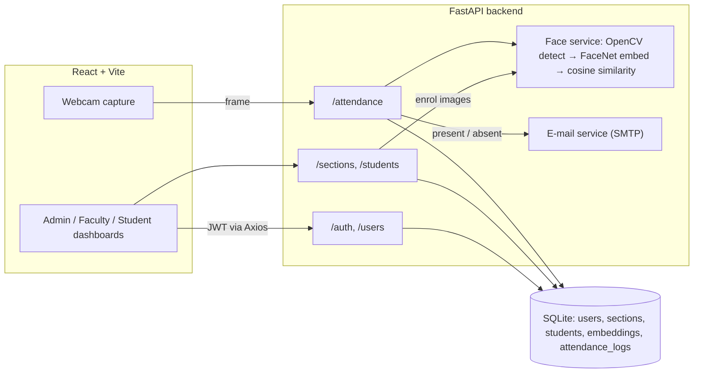

# SmartAttend: Face Recognition Attendance System

Marks a whole classroom's attendance from one webcam frame by recognising multiple faces at once, with dashboards for Admin, Faculty and Students.

[](https://github.com/ayyappareddynandipati/SmartAttend/actions/workflows/ci.yml)
[](LICENSE)


**Live demo:** TODO: add the Vercel URL after deployment (see [Deployment](#deployment))

<!-- TODO: record a 20–30 s GIF of a Faculty session recognising faces and save it as docs/demo.gif, then uncomment: -->
<!--  -->

| Admin dashboard | Faculty live session | Student dashboard |
|---|---|---|
| TODO: `docs/screenshots/admin-dashboard.png` | TODO: `docs/screenshots/faculty-session.png` | TODO: `docs/screenshots/student-dashboard.png` |

## Problem → Solution

- **Problem:** Roll calls in large classes waste time and allow proxy attendance, and biometric devices need extra hardware.
- **Solution:** Faculty point an ordinary webcam at the class. SmartAttend detects every face, matches each one to enrolled students in that section, and logs them as present with a confidence score.
- **Result:** Attendance is recorded per session, students can see their own records, and Faculty can download CSV/Excel reports.

## Features

- **Multi-face recognition:** OpenCV face detection and FaceNet embeddings (DeepFace), matched by cosine similarity (match when similarity > 0.70).
- **Face enrolment:** Admin enrols students by webcam capture or image upload; the largest face in each image is used.
- **Role-based access:** JWT login; Admin, Faculty and Student dashboards behind role-protected routes; new users must change their password on first login.
- **Attendance sessions:** a student detected several times in one session is logged once; completing a session returns present and absent lists.
- **Reports:** download a session's attendance as CSV or Excel.
- **E-mail notifications:** students are e-mailed when marked present, and absent students when a session is completed (SMTP, optional).

## Tech Stack

| Layer | Technologies |
|---|---|
| Frontend | React 19, Vite 7, Material UI 7, React Router 7, Axios, react-webcam |
| Backend | Python 3.11, FastAPI, Uvicorn, SQLAlchemy, SQLite |
| Auth | JWT (python-jose), PBKDF2-SHA256 password hashing (passlib) |
| Face recognition | DeepFace (FaceNet), OpenCV, SciPy cosine similarity |
| Reports & e-mail | pandas, openpyxl, smtplib |
| Quality | pytest, Vitest, React Testing Library, ruff, ESLint, Prettier, GitHub Actions |

## Architecture



## API Endpoints

Interactive docs are at `/docs` when the backend is running.

| Method | Endpoint | Access | Description |
|---|---|---|---|
| POST | `/auth/token` | Public | Log in (form data) and get a JWT |
| POST | `/auth/forgot-password` | Public | Reset a password by username (see [Future Improvements](#future-improvements)) |
| POST | `/users/` | Admin | Create a user |
| GET | `/users/` | Admin | List users |
| DELETE | `/users/{user_id}` | Admin | Delete a user (not yourself) |
| POST | `/users/change-password` | Logged in | Change own password |
| POST | `/users/{user_id}/reset-password` | Admin | Reset a user's password |
| POST | `/sections/` | Admin | Create a section |
| GET | `/sections/` | Logged in | List sections |
| GET | `/sections/{section_id}` | Logged in | Get a section |
| PUT | `/sections/{section_id}` | Admin | Update a section |
| DELETE | `/sections/{section_id}` | Admin | Delete a section with no students |
| POST | `/students/` | Admin | Add a student and create their login (username and initial password = roll number) |
| GET | `/students/` | Logged in | List students with enrolment status |
| PUT | `/students/{student_id}` | Admin | Update a student |
| DELETE | `/students/{student_id}` | Admin | Delete a student and their login |
| POST | `/students/{student_id}/enroll` | Admin | Upload face images to enrol |
| POST | `/attendance/recognize` | Logged in | Recognise faces in a frame and mark attendance |
| GET | `/attendance/logs/{session_id}` | Logged in | Attendance log for a session |
| GET | `/attendance/export/{session_id}?format=csv\|excel` | Logged in | Download a session report |
| GET | `/attendance/my-logs` | Student | Own attendance history |
| POST | `/attendance/session/{session_id}/complete` | Logged in | Complete a session and e-mail absentees |

## Getting Started

**Prerequisites:** Python 3.11, Node.js 20+, Git

```bash
git clone https://github.com/ayyappareddynandipati/SmartAttend.git
cd SmartAttend
```

**1. Backend** (the first install downloads TensorFlow and takes a few minutes)

```bash
cd backend
python -m venv venv
source venv/bin/activate              # Windows: venv\Scripts\activate
pip install -r requirements.txt

cp .env.example .env                  # Windows: copy .env.example .env
python -c "import secrets; print(secrets.token_hex(32))"   # paste the output as SECRET_KEY in .env

python app/create_initial_data.py     # creates tables and the default admin
uvicorn app.main:app --reload --port 8000
```

`backend/.env.example`:

```env
SECRET_KEY=
CORS_ORIGINS=
SMTP_SERVER=
SMTP_PORT=
SMTP_USERNAME=
SMTP_PASSWORD=
```

SMTP is optional. Without it, e-mails are written to the server log instead of being sent.

**2. Frontend** (new terminal)

```bash
cd Frontend
npm install
npm run dev
```

Open http://localhost:5173 and log in with the local default admin `admin` / `admin123`, created by `create_initial_data.py`. You'll be asked to change the password on first login. To use a different backend URL, set `VITE_API_URL` (see `Frontend/.env.example`).

## Testing

```bash
# Backend: 26 pytest tests (auth, roles, users, sections, students, attendance export)
cd backend
pip install -r requirements-test.txt
ruff check .
pytest -q

# Frontend: 12 Vitest + React Testing Library tests (Login, PrivateRoute, session storage)
cd Frontend
npm run lint
npm test
```

Backend tests use an in-memory SQLite database and stub the face-recognition service, so they run in seconds without TensorFlow. CI runs all of this, plus Prettier and `npm run build`, on every push and pull request.

## Deployment

Free-tier plan: **frontend on Vercel**, **backend on Render**. This project uses SQLite, so MongoDB Atlas isn't needed.

**Backend: Render (Web Service)**
1. On [render.com](https://render.com), choose **New → Web Service** and connect this repo.
2. Set **Root Directory** to `backend`, **Runtime** to Python 3, **Build Command** to `pip install -r requirements.txt && python app/create_initial_data.py`, and **Start Command** to `uvicorn app.main:app --host 0.0.0.0 --port $PORT`.
3. Under **Environment**, add `SECRET_KEY` (a random 64-character hex string), `CORS_ORIGINS` (your Vercel URL, e.g. `https://smartattend.vercel.app`), `PYTHON_VERSION=3.11.9`, and optionally the `SMTP_*` values.
4. Deploy, then open `https://<your-service>.onrender.com/docs` to check it's running.

> ⚠️ TensorFlow + DeepFace may need more memory than Render's free 512 MB instance provides. If the service crashes with out-of-memory, use a paid instance or run the backend locally for demos.
> ⚠️ Render's free disk is temporary, so the SQLite database resets on every redeploy or restart. That's fine for a demo but not for real use.

**Frontend: Vercel**
1. On [vercel.com](https://vercel.com), choose **Add New → Project** and import this repo.
2. Set **Root Directory** to `Frontend` (Vercel detects Vite), and add the environment variable `VITE_API_URL=https://<your-service>.onrender.com`.
3. Deploy. `Frontend/vercel.json` already rewrites all routes to `index.html`, so refreshing `/admin` or `/faculty` works.
4. Put the Vercel URL in this README's **Live demo** line and in the repo's **About → Website** field.

<!-- TODO: after deploying, create a demo faculty account with demo-only credentials and list it here. Do not publish the admin login while /auth/forgot-password allows resets by username. -->

## Folder Structure

```
SmartAttend/
├── .github/workflows/ci.yml   # Lint, test and build on push / PR
├── backend/
│   ├── app/
│   │   ├── api/               # auth, users, sections, students, attendance, deps
│   │   ├── core/              # config (.env), database, security (JWT, hashing)
│   │   ├── models/            # SQLAlchemy models
│   │   ├── services/          # face_recognition.py, email_service.py
│   │   ├── create_initial_data.py
│   │   ├── init_db.py
│   │   └── main.py            # FastAPI app, CORS, routers
│   ├── tests/                 # pytest suite
│   ├── .env.example
│   ├── requirements.txt
│   ├── requirements-test.txt
│   └── ruff.toml
├── Frontend/
│   ├── src/
│   │   ├── __tests__/         # Vitest + RTL tests
│   │   ├── api/               # Axios client with JWT interceptor
│   │   ├── components/        # layout, common UI, PrivateRoute, ChangePassword
│   │   ├── context/           # AuthContext (multi-role sessions)
│   │   ├── pages/             # Login, Admin, Faculty, Student dashboards
│   │   ├── styles/
│   │   └── utils/             # sessionManager.js
│   ├── .env.example
│   ├── vercel.json
│   └── package.json
├── PRD                        # Product requirements document
└── LICENSE
```

## Future Improvements

- **Secure password reset:** `/auth/forgot-password` currently resets any account by username alone. Replace it with an e-mailed reset link or OTP.
- **Restrict faculty endpoints:** attendance session and export routes accept any logged-in user; limit them to Faculty/Admin.
- **Production database:** move from SQLite to PostgreSQL for persistent hosted data.
- **Liveness detection:** prevent attendance being marked from a photo of a student.
- **Code-splitting:** the production bundle is over 500 kB; lazy-load the dashboards.

## Author

**Ayyappa Reddy Nandipati**, Full Stack Developer · ServiceNow CSA & CAD
[Portfolio](https://ayyappareddy.vercel.app) · [LinkedIn](https://www.linkedin.com/in/ayyappareddynandipati) · [ayyappareddynandipati@gmail.com](mailto:ayyappareddynandipati@gmail.com)

Licensed under the [MIT License](LICENSE).
